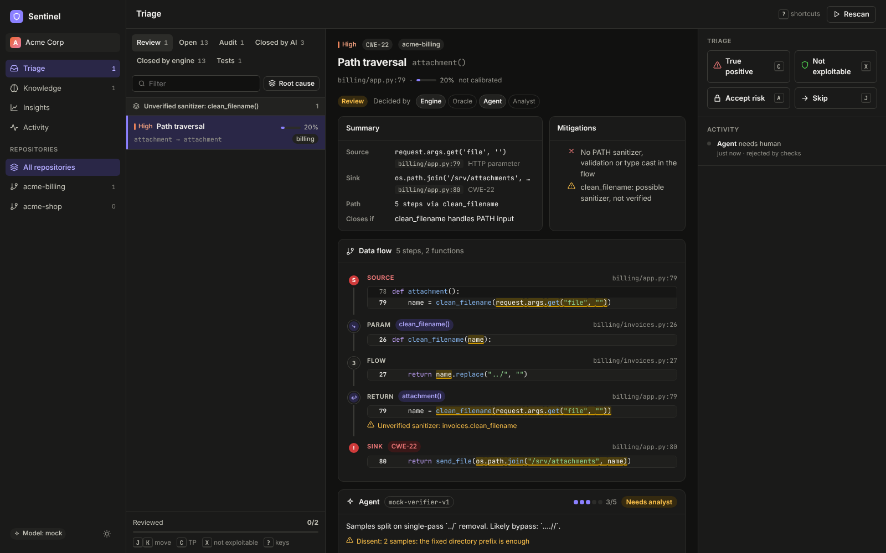

# Sentinel: neurosymbolic SAST with a triage data flywheel (POC)

Sentinel finds injection-class vulnerabilities with very few false positives. It works by splitting the job:

- **Semgrep** locates sources, sinks and sanitizers. Spec packs are plain Semgrep YAML.
- **A Datalog engine** (clingo) proves or refutes every source→sink flow across functions. Each decision names its mitigation, and full provenance is kept.
- **Neural tiers** handle only what the engine cannot decide:
  - Tier 1, a spec oracle, labels an unmodelled API or guard.
  - Tier 2, a tool-using verifier agent, judges the rest.

  Their output must pass **symbolic gates**: hash-checked citations, unanimous votes, and the engine re-deriving the verdict from the agent's own facts.
- **The flywheel.** Every agent verdict and every human triage decision becomes a *knowledge item*: a versioned Datalog fact with provenance, gated by canary replay and an impact budget. Each scan therefore needs fewer AI calls and fewer human decisions.
- **Learned spec rules.** Confirmed flows through shared helpers, and sanitizer judgements, also produce Semgrep spec rules. A synthesizer writes each rule. It is validated by a patch-differential oracle, a generalization check and the canaries before it can apply. Rules model helpers whose source a repository does not contain, and `export-rules` hands them to plain Semgrep in CI.
- **A triage UI** built for analysts:
  - evidence-first findings, with "why it's a finding / why it might not be" and a counterfactual
  - the source→sink trace over your real code
  - keyboard-first triage, root-cause grouping, and an impact preview before you teach the engine
  - a knowledge workbench, and flywheel insights

The research behind the design is in [`docs/literature.md`](docs/literature.md) (5 research tracks, with per-paper notes in [`docs/lit/`](docs/lit)). The design itself is in [`docs/architecture.md`](docs/architecture.md), and results are in [`docs/evaluation.md`](docs/evaluation.md).



## Quickstart

```bash
cd sast
python3 -m venv .venv && .venv/bin/pip install clingo fastapi uvicorn pyyaml pytest httpx anthropic playwright
python3 -m venv .venv-semgrep && .venv-semgrep/bin/pip install semgrep   # separate env: dependency pins conflict
(cd ui && npm install && npx vite build)

PYTHONPATH=. .venv/bin/python -m sentinel demo     # onboard acme-shop, AppSec review, rescan, onboard acme-billing
PYTHONPATH=. .venv/bin/python -m sentinel serve    # http://127.0.0.1:8077
PYTHONPATH=. .venv/bin/python -m sentinel eval     # precision/recall per stage -> docs/evaluation.json
PYTHONPATH=. .venv/bin/python -m sentinel export-rules --org acme -o rules.yml   # curated + learned rules for CI
PYTHONPATH=. .venv/bin/python -m pytest -q         # 132 tests (incl. 2 browser E2E)
```

Inbox keys: `j`/`k` move · `c` confirm · `x` not exploitable (then `1`–`9` reason, `↵` commit) · `a` accept risk · `.` apply to root-cause group · `u` undo · `g` grouping · `[`/`]` lanes · `?` help.

## Using a real model

The agent and oracle run as deterministic **mocks** by default. Nothing in the POC needs an API key. To use Claude:

```bash
export SENTINEL_LLM=claude          # plus Anthropic credentials (ANTHROPIC_API_KEY or `ant auth login`)
export SENTINEL_SAMPLES=3           # independent verifier trajectories per finding (votes)
```

`sentinel/agent/claude.py` implements the same contracts:
- a manual tool loop over read-only tools (`read_span` returns the sha256 that every citation must carry)
- a structured-output verdict
- k-sample voting, and refusals treated as abstentions

It is covered offline by `tests/test_claude_client.py` against a scripted fake of the API. It has not been run against the live API in this POC.

## Layout

```
sentinel/
  extract/   python_facts.py (AST → value-flow facts, guards, routes) · semgrep_specs.py (spec matching + baseline)
  engine/    datalog.py (clingo + provenance instrumentation) · rules/taint.lp, decide.lp · analyze.py
  agent/     interfaces.py · mock.py · claude.py · orchestrator.py (tools + gates)
  learn/     knowledge.py (lifecycle, gates) · rules.py (learned spec rules: validation gate, export) · bayes.py (Bingo-style ranking)
  pipeline.py (Tier 0 → 1 → 2, caching, persistence) · triage.py · explain.py · eval.py · api/app.py · cli.py
specs/       Semgrep spec pack            canaries/  known-vulnerable corpus used by the knowledge gates
demo/        acme-shop, acme-billing, acme-admin (installs acme_common) (+ ground_truth.yaml, outside the scanned trees)
ui/          React + TypeScript triage UI  tests/  pytest suite + Playwright screenshot script
```

## Honest limits

- The mock agent is tuned to the demo corpus, so the Tier-2 numbers validate the *machinery* (gating, flywheel, persistence), not model quality.
- Python/Flask only; flow-insensitive heap; method calls on objects are not resolved; no Soufflé backend yet. The production roadmap is in `docs/architecture.md` §10.
- During the literature review, arXiv, ACM, USENIX and OpenReview were blocked by the environment's network policy. Numbers were taken from search-engine extracts of the primary pages and are tagged in `docs/lit/`.
